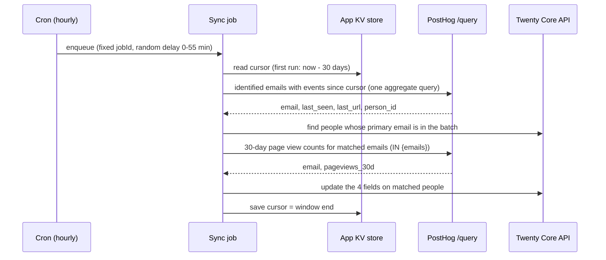
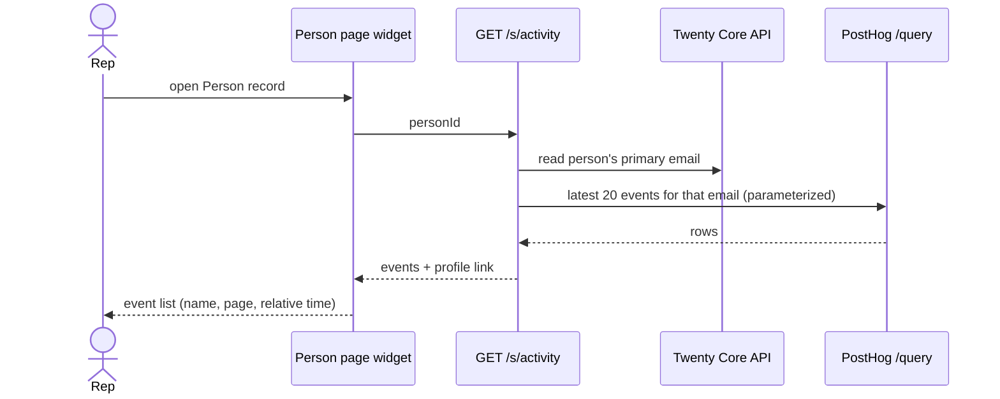
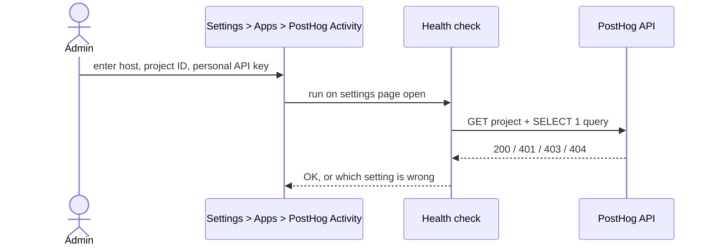

# PRD: PostHog Activity for Twenty CRM

**App slug:** `posthog-activity-sync`
**Status:** Draft, pending approval
**Type:** Twenty App (SDK 2.54.3): Person fields + scheduled background job + HTTP route + record-page widget + view
**Effort:** Medium-low (4-6 days for v1)
**External dependencies:** the customer's PostHog project (Cloud US, Cloud EU or self-hosted) and a PostHog personal API key with the `query:read` scope
**Source brief:** `ideas/03-posthog-activity-sync/03-posthog-activity-sync.md` (several of its technical assumptions are corrected here; see Current State)

---

## Summary

Shows each contact's website and product activity from PostHog on their Twenty record. A
**Product activity** widget on the Person page lists the person's latest events (page views and
custom events, with URLs and times), fetched live from PostHog when the record is opened. Four
summary fields (last seen, last page, page views in the last 30 days, link to the person in
PostHog) are kept up to date by an hourly sync, so reps can sort and filter people by recent
activity. No raw PostHog events are copied into Twenty.

## Problem Statement

A team that tracks its website or product with PostHog and sells with Twenty has no way to see,
on a contact's record, what that contact has done: which pages they viewed, when they were last
active, whether they came back after a demo. HubSpot shows page views on the contact record
natively. That gap is a stated blocker for teams leaving HubSpot: in Twenty discussion
[#16735](https://github.com/twentyhq/twenty/discussions/16735) (2026-05-31), a user evaluating
the move, after talking with Twenty's co-founder, called a PostHog integration "critical" and
named it as one of the issues blocking them from leaving HubSpot, because pageviews give
"context to the sales phone call".

Today's workaround is to open PostHog in another tab, search the person by email, and read
their event list, before every call. Most reps don't do it.

**Affected:** the sales rep preparing a call or prioritising follow-ups (primary), and the
customer-success or support person checking whether an account is actually using the product
(secondary).

## Goals

- A rep opening a Person whose email is known to PostHog sees their latest 20 events within
  **3 seconds** (p95), without leaving Twenty.
- Each Person with PostHog activity carries **Last seen**, **Last page**, **Page views (30 days)**
  and a **PostHog profile link**, refreshed at least **hourly**, usable in sorts, filters, views
  and workflows.
- Setup takes **under 5 minutes**: three settings and a health check that says whether they work.
- PostHog load stays inside what PostHog supports: a few aggregate queries per workspace per hour
  plus one small query per widget view; well under the 2,400 queries/hour project limit and the
  free plan's read budget at the reference volume (5,000 people, 1M events/month).
- **No event-level PostHog data is stored in Twenty.** Only the four summary fields.

## Non-Goals

- Copying PostHog events into Twenty records or a custom object (see Current State: PostHog
  does not support recurring exports over `/query`).
- Anonymous visitor tracking. Only people identified in PostHog with an email are matched.
- Sending Twenty data into PostHog (PostHog already ships a Twenty data source for that).
- Embedding session replays, funnels or charts.
- A paid tier (services-led distribution per `decisions.md`).

## Current State

- **No PostHog app exists for Twenty** (npm `keywords:twenty-app` and GitHub searched
  2026-11-01). PostHog has a *source* that imports Twenty into PostHog, not the reverse.
- **Corrections to the source brief**, from PostHog's docs and source (2026-11-01):
  - `/query` is for ad-hoc analytics and embedded use. "Bulk or recurring exports of `events`,
    `persons` ... are not supported", and "Connectors built on `/query` are not supported and
    will be rate-limited or rejected"
    ([posthog.com/docs/api/queries](https://posthog.com/docs/api/queries)). The brief's design
    (pull each person's last 20 events into a `webActivity` object every 15 minutes) is that
    pattern, so it is replaced. "Pulling aggregated PostHog data into your own or other apps" is
    a listed supported use.
  - The legacy `GET /api/projects/:id/events` endpoint is deprecated and returns only the last
    24 hours without `after`. Not used.
  - `OFFSET` returns HTTP 400 for personal API keys. Paging is keyset on `timestamp`.
  - Query rows default to 100 and cap at 50,000; queries time out at 10 s and may queue 30 s.
- **Twenty SDK 2.54.3** (installed types + docs.twenty.com, 2026-11-01):
  - Per-workspace settings: `applicationVariables` with `isSecret`, set by an admin under
    Settings > Apps > (app). Logic functions read them as `process.env.KEY`; secrets are never
    exposed to front components. (`serverVariables` are shared by all installs, so not for a
    customer's key.)
  - `defineHealthCheck` runs server-side when the app's settings page opens and reports OK or an
    error with a message: the "test connection".
  - Logic functions may `fetch()` external HTTPS hosts; no network capability or allowlist exists.
  - `definePageLayoutWidget` adds a front component to the standard Person record Home tab.
    Front components call the app's own routes with `RestApiClient` (as lead-scoring's status
    page does).
  - **Rate limit:** 500 Twenty API requests per minute **per app registration, shared by every
    install**, for cron and background work. Cron ticks fire in every workspace at the same minute,
    so docs recommend a cron that only enqueues a job with a random `delayMs`. Job enqueues are
    capped at 2,000/minute per app.
  - `createTimelineActivity` and `defineTimelineActivityType` exist (beta) for native timeline
    rows; rows survive uninstall as snapshots. Deferred to Phase 2.
- Reference implementation in house: `lead-scoring-agent` (person fields, cron, routes, page,
  least-privilege role, marketplace listing).

## User Personas

| Persona | Description | Primary action |
|---|---|---|
| Sales rep | Calls and emails leads from Twenty | Opens a person before a call, reads what they did on the site; sorts leads by Last seen |
| Customer success | Watches existing customers' product usage | Filters people by Page views (30 days) to spot drop-off |
| Workspace admin | Installs and configures apps | Enters PostHog host, project ID and key; checks the health status |

## Proposed Solution

**Approach B: aggregate sync + live detail.** Chosen over two alternatives:

| Approach | Description | Verdict |
|---|---|---|
| A. Event copy (the brief) | Every 15 min, query each person's last 20 events and store them in a `webActivity` object | **Rejected.** A recurring per-record export over `/query`, which PostHog says it will rate-limit or reject. One query per person does not scale. Stores third-party event data in Twenty, so dedup, retention and GDPR deletion become our problem |
| **B. Aggregate sync + live widget** | Hourly: a few batched aggregate queries update 4 summary fields. On record open: one live query for that person's latest events | **Chosen.** Inside PostHog's supported uses; fixed, small query count; nothing event-level stored; detail always current |
| C. Push via PostHog webhook destination | PostHog sends each event to a public Twenty route in real time | **Phase 2 option.** Real time and no query budget, but costs $0.0005/event after 10k/month, must be configured inside each customer's PostHog, brings no history, and needs an unauthenticated receiver |

**Matching** is by email: Twenty `emails.primaryEmail`, lowercased, against PostHog
`persons.properties.email`, lowercased. Joining events to the `persons` table (not the event's
captured person properties) means anonymous events from before a person was identified count too.

**Settings** (`applicationVariables`, workspace scope):

| Key | Type | Notes |
|---|---|---|
| `POSTHOG_HOST` | SELECT: `https://us.posthog.com`, `https://eu.posthog.com`, custom | Private API host, not the `*.i.posthog.com` ingestion host |
| `POSTHOG_CUSTOM_HOST` | TEXT | Only when host is custom (self-hosted) |
| `POSTHOG_PROJECT_ID` | TEXT, required | Settings > Project > Variables in PostHog |
| `POSTHOG_PERSONAL_API_KEY` | TEXT, secret, required | `phx_...`, scope `query:read`, restricted to this project |

**Person fields** (all nullable, `isAuditLogged: false` so syncs don't fill the timeline):

| Field | Type | Meaning |
|---|---|---|
| `posthogLastSeenAt` | DATE_TIME | Time of the person's latest PostHog event |
| `posthogLastPage` | LINKS | `$current_url` of the latest `$pageview` |
| `posthogPageviews30d` | NUMBER | `$pageview` events in the trailing 30 days |
| `posthogProfile` | LINKS | The person's page in PostHog (events, session replays) |

**Components:** a health check, an hourly cron that only enqueues the sync job, the sync job
(KV cursor), a daily recount job, a `GET /s/activity` route for the widget, the widget, a
"Recently active people" view, and a least-privilege role (read and update Person only).

### Behavioral Flows

Hourly sync:

Rep opens a person:

Setup:

## Happy Path

1. Admin installs the app, creates a PostHog personal API key (`query:read`, this project only),
   and enters host, project ID and key. The health check shows **OK**.
2. Within an hour the first sync runs: it looks back 30 days, finds identified PostHog people with
   emails, matches them to Twenty people, and fills the four fields.
3. A rep opens **Recently active people** (sorted by Last seen) and sees who was on the site today.
4. The rep opens Maya's record. The **Product activity** widget lists her last 20 events:
   `/pricing` 2 hours ago, `/docs/api` yesterday, `signup_completed` last week, with a link to
   her PostHog profile.
5. Every hour the sync updates people active since the last run; once a day the 30-day counts are
   recomputed so inactive people decay to 0.

## Edge Cases and Failure Modes

| Scenario | Expected behaviour |
|---|---|
| App not configured or key invalid | Health check shows ERROR naming the setting; sync job exits without calling PostHog; widget shows "Connect PostHog in Settings > Apps" |
| Person has no primary email | Widget: "No email on this person"; sync ignores them |
| Email not found in PostHog | Widget: "No PostHog activity for this email"; fields stay empty |
| Same email on two Twenty people | Both are updated; the widget works on each |
| Person's email changes | Next sync matches the new email; old values stay until the new email has activity (documented) |
| PostHog `429` (rate limit or `api_queries_budget_exceeded`) | Sync stops, keeps its cursor, logs `Retry-After`; next run resumes. Widget shows "PostHog is busy, try again in a minute" |
| PostHog query timeout (10 s) | Sync halves the time window and retries once; widget shows a retry message |
| More than 5,000 active people in one window | Sync processes 5,000, advances the cursor to the last processed `last_seen`, and continues next run (keyset on timestamp) |
| Two sync runs overlap | Prevented: the cron enqueues with a fixed `jobId`, and the queue won't start a second run while one is held |
| Mixed-case emails | Both sides lowercased before comparing |
| Anonymous events before identify | Counted, because events join to the merged `persons` row |
| Person deleted in PostHog (GDPR) | Widget stops showing their events immediately; summary fields clear on the daily recount |
| App uninstalled | The four fields and their values are removed with the app |
| Twenty API budget (500/min shared) | Job is spread by random delay; person updates are batched; at most one sync per workspace per hour |

## Technical Constraints

- **PostHog `/query`:** 240/min, 2,400/hour, 3 concurrent per project; plus an hourly read budget
  in bytes for personal-key queries (smaller on the free plan). 10 s execution limit. Keyset
  pagination only. Values must be passed as `values` placeholders (bound parameters), never
  interpolated.
- **Query budget per workspace:** sync ~2 queries/hour + daily recount ~1 query per 500 recently
  active people + 1 query per widget open. Every query filters on `timestamp` to limit bytes read.
- **Twenty:** 500 API requests/min per app registration across all installs; 2,000 job
  enqueues/min; logic function timeout max 900 s. The sync job uses `timeoutSeconds: 300`.
- **Auth:** PostHog personal API key in a secret `applicationVariable` (encrypted at rest, never
  sent to the browser). PostHog recommends OAuth for apps installed by other PostHog users;
  Twenty's `connectionProviders` support OAuth but require a registered OAuth client. Phase 2.
- **Permissions:** role reads and updates Person only. No company, opportunity, AI or
  timeline access in Phase 1.
- **Privacy:** what leaves Twenty is person **email addresses**, sent to the customer's own
  PostHog as query parameters. What comes back and is stored: the four summary fields. Event
  lists are shown, not stored. EU customers should use `eu.posthog.com`.

## Scope

### Phase 1 (Current Work)

- Settings variables + `defineHealthCheck` (host, project ID, key; distinguishes bad key, missing
  scope, wrong project, unreachable host).
- Four Person fields.
- Hourly cron → enqueue sync job (fixed `jobId`, random delay); sync job with KV cursor,
  30-day initial lookback, keyset continuation, 429/timeout handling.
- Daily recount job for `posthogPageviews30d` on people seen in the last 31 days.
- `GET /s/activity?personId=` route (auth required) and the **Product activity** widget on the
  Person Home tab (twenty-ui, empty and error states, link to PostHog profile).
- **Recently active people** view (Last seen not empty, sorted desc).
- Least-privilege role; README with privacy, pricing, support; gallery images; listing metadata.
- Seed script for a demo PostHog project (capture API, `$identify` with emails matching the demo
  workspace's people).

### Phase 2 (Future)

- Key events on the Timeline: admin picks events (e.g. `signup_completed`, `/pricing` view),
  written with `createTimelineActivity` (beta API; rows survive uninstall, so needs its own privacy
  note).
- OAuth sign-in to PostHog via `connectionProviders`, if PostHog allows third-party OAuth clients.
- Company rollup: activity across all people at a company domain.
- Match on additional emails, not only primary.
- Optional real-time path via a PostHog webhook destination for chosen events.
- Workflow examples: "create a task when a lead views /pricing twice in a week".

### Out of Scope

- Storing raw PostHog events in Twenty; anonymous-visitor matching; writing to PostHog; replays
  and charts; official support for self-hosted PostHog beyond "custom host, best effort" (PostHog
  itself calls hobby self-hosting unsupported).

## Risks & Mitigations

| Risk | Impact | Mitigation |
|---|---|---|
| PostHog treats the app as an unsupported `/query` connector | Throttled or rejected queries | Design stays in supported uses (aggregates + embedded per-person lookups); small fixed query count; keys are the customer's own; track PostHog OAuth for Phase 2 |
| Free-plan read budget exhausted on busy projects | Sync stalls, widget errors | Time-bounded queries, 429 handling with cursor kept, daily (not hourly) recount; measure bytes read on the demo project before release |
| Customer doesn't identify users with email in PostHog | App shows nothing | README prerequisite with the one-line `posthog.identify(..., { email })` snippet; health check WARNING when the project has no persons with an email property |
| Twenty's shared 500 req/min app budget at many installs | 429s from Twenty | Hourly spread with random delay; batched updates; nothing runs per minute |
| Live widget latency (PostHog queue up to 30 s) | Slow panel | Narrow query (90-day window, 20 rows), loading state, 8 s client timeout with retry |
| Email mismatch (aliases, case, multiple emails) | Missed matches | Lowercasing; primary email only in Phase 1, additional emails in Phase 2 |
| Timeline API (beta) changes | Phase 2 rework | Kept out of Phase 1 |

## Acceptance Criteria

- [ ] With valid settings the health check shows OK; with a bad key, missing `query:read`, wrong
      project ID or unreachable host it shows ERROR naming the cause.
- [ ] After the first sync on the demo project, every demo person with seeded activity has
      `posthogLastSeenAt`, `posthogLastPage`, `posthogPageviews30d` and `posthogProfile` set,
      matching PostHog's own person page.
- [ ] People with no PostHog activity have empty fields; nothing else on Person changes.
- [ ] A second sync with no new events makes no Person updates (verified in Settings > Logs >
      Record changes).
- [ ] Opening a seeded person shows their latest events within 3 s; a person without email or
      without activity shows the matching empty state.
- [ ] HogQL is built only with `values` placeholders; a test with an email containing `'`, `)`
      and `--` returns no error and no extra rows.
- [ ] Simulated PostHog 429 keeps the cursor and the next run resumes; no duplicate work.
- [ ] Simulated overlap (two enqueues) results in one run.
- [ ] Per hourly cycle on the demo workspace: at most 3 PostHog queries and at most
      (matched people + 5) Twenty API requests.
- [ ] Role grants read and update on Person only; uninstall removes the four fields.
- [ ] README states what leaves the workspace (emails to the customer's PostHog), what is stored,
      and how to delete it.

## Technical Implementation Strategy

1. **Spike (half day):** create a PostHog Cloud project, seed it with the capture script, and run
   both HogQL queries by `curl` with a `query:read` key. Confirm: `IN {emails}` with a list value,
   the `persons` join for pre-identify events, `lower()` matching, response shape, and bytes read
   (`X-PostHog-Query-Bytes-Read`). Record findings in a decision record.
2. **Scaffold** `posthog-activity-sync` from the `lead-scoring-agent` layout (SDK 2.54.3, Node 24,
   Corepack Yarn, vitest, oxlint, publish workflow with npm trusted publishing).
3. **`src/lib/posthog-client.ts`:** `runQuery(sql, values)` posting to
   `{host}/api/projects/{id}/query/` with `Authorization: Bearer`, `refresh: 'blocking'`; maps
   401/403/404/429/timeouts to typed errors carrying `Retry-After`.
4. **`src/lib/queries.ts`:** the three HogQL builders (active-since-cursor aggregate, 30-day
   counts for an email list, latest events for one email). Pure functions, unit tested.
5. **Health check** (`defineHealthCheck`): validates settings, calls `GET /api/projects/{id}/`
   and a `SELECT 1` query, maps errors to messages.
6. **Fields** (`defineField` × 4 on Person) and the **view**.
7. **Sync:** hourly cron function that calls `enqueueJob` with a fixed `jobId` and random
   `delayMs`; the job reads the KV cursor, runs the aggregate query, matches Twenty people in
   batches of 100 by primary email, runs the counts query, writes fields, saves the cursor.
   Daily cron enqueues the recount job.
8. **Route + widget:** `GET /s/activity` (`isAuthRequired: true`) returns
   `{ status, events[], profileUrl }`; widget via `defineFrontComponent` +
   `definePageLayoutWidget` on `personRecordPage.tabs.home`, using `useSelectedRecordIds()` and
   twenty-ui.
9. **Role:** read + update on Person only.
10. **Tests:** query builders (injection cases), client error mapping, sync job with mocked
    PostHog and Core API (cursor, 429, keyset continuation, no-op second run), route states.
11. **Verify on the Cloud demo workspace** with real PostHog data, then listing assets, release.

Key files: `src/application-config.ts`, `src/default-role.ts`, `src/fields/*`,
`src/health-check.ts`, `src/logic-functions/{sync-cron,sync-job,recount-cron,recount-job,activity-route}.function.ts`,
`src/lib/{posthog-client,queries,match-people}.ts`, `src/front-components/product-activity.tsx`,
`src/page-layout/product-activity.widget.ts`, `src/views/recently-active-people.view.ts`,
`scripts/seed-posthog.sh`.

## Open Questions

- **Batch Person updates:** can `CoreApiClient` update many people in one request (e.g.
  `createPeople` with `upsert: true` and only `id` + the four fields), or is it one request per
  person? Decides the Twenty request budget per sync.
- **Twenty email filter:** is an `in` filter on `emails.primaryEmail` case-sensitive? If so, match
  in memory after fetching candidates.
- **PostHog third-party OAuth:** can an outside app register a PostHog OAuth client today? If yes,
  Phase 2 replaces the personal key.
- **Cron overlap and minimum interval:** confirm that a fixed `jobId` prevents a second concurrent
  run on Cloud (docs say so; verify).
- **Health check WARNING for "no persons with email":** costs one extra query per settings page
  open; confirm it stays inside the budget or make it a one-time check.
- **Data residency:** a Twenty Cloud (US) workspace pulling summary fields from PostHog EU copies
  a small amount of EU-hosted data to the US. Document in the README; decide whether to warn in
  the health check.
